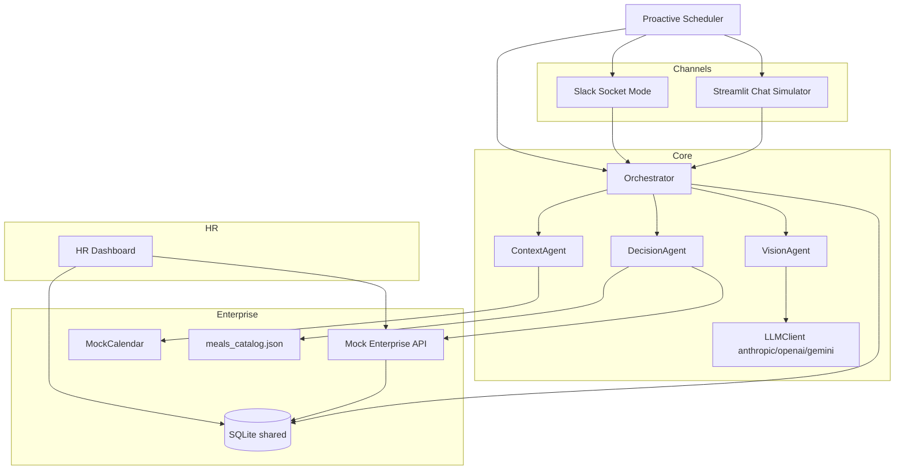

# Autonomous Corporate Wellness & Health Agent

Hackathon demo for **Misk Humain Future AI Builders** — Autonomous Enterprise track.

An enterprise multi-agent system that protects employee energy **during work hours only**: it reads privacy-safe calendar signals, estimates macros for a logged meal (photo or text), scores post-meal slump risk against upcoming meetings, and recommends one intervention (snack, walk, movement break, hydration, or none). Snacks come **only** from a curated catalog. Spending always needs an explicit Confirm click. HR sees aggregated, k-anonymous analytics.

> **Wellness guidance only — not medical advice.**

---

## Problem

Meetings stack up after heavy lunches. Employees hit a 13:30–15:00 energy dip, skip movement, and either over-caffeinate or order poorly timed meals. Existing wellness tools track daily calories or after-hours lifestyle — they miss the **in-work-hours** decision window and often leak calendar titles or individual health detail to HR.

## Solution overview

| Layer | Role |
| --- | --- |
| **VisionAgent** | Image or AR/EN text → estimated per-meal macros + confidence |
| **ContextAgent** | Remaining calendar (no titles), meal/movement gaps, wallet, free slots |
| **DecisionAgent** | Tool-using policy: one intervention; catalog-only snacks; least-cost bias |
| **Channels** | Pluggable: Streamlit Slack-like simulator (always) + Slack Socket Mode |
| **Scheduler** | Proactive scan every 15 min (or on-demand for demo at DEMO_CLOCK 12:20) |
| **Mock enterprise API** | Calendar, wallet, orders, HR metrics, demo clock/reset |
| **HR dashboard** | Four tabs: Overview, Live Feed, Agent Trace, Governance |

All impact / savings numbers are badged **Simulated data**.

## Architecture



## Agent flow

1. Employee logs a meal (photo / text) **or** scheduler fires a proactive check.
2. **VisionAgent** returns `MealMacros` (or a clarifying question if confidence &lt; 0.5).
3. **ContextAgent** loads remaining events (start/end/importance/attendee_count only), gaps, wallet.
4. Deterministic **slump heuristic** produces a 0–100 score; LLM may only explain/refine wording.
5. **DecisionAgent** picks one intervention; snack `meal_id` must come from catalog tools.
6. Channel renders macros, risk badge, reasoning, buttons. **Confirm** creates order + wallet debit.
7. Trace steps and anonymized decisions land in SQLite for the HR dashboard within ~3s.

### Why this counts as “autonomous”

- **Proactive trigger** without waiting for a user open (scheduler + DEMO_CLOCK).
- **Tool use** for schedule, free slots, catalog search, wallet, break booking.
- **Governed actions**: quiet hours, dietary filters, daily/weekly caps, max 3 proactive msgs/day, human confirmation for any spend.

## Privacy by design

- Work hours only (default 08:00–16:00). **No daily calorie budgets** anywhere.
- Calendar titles never reach the LLM or HR — only start, end, importance, attendee_count.
- HR views are aggregated; **k-anonymity** hides groups with &lt; 5 employees (configurable).
- Opt-in required for proactive messaging; audit log on Governance tab.

## Slump heuristic (wellness tool, not medical)

Documented, unit-tested, deterministic Python in `heuristic.py`:

- Higher **refined carbs + sugar + fat** relative to **protein + fiber** raises the score.
- Meal heaviness (kcal bands) and afternoon window (12:30–15:00) adjust it.
- A **high-importance** meeting **30–120 minutes** after a heavy meal raises urgency.
- LLM never owns the base score — it explains; fallbacks keep demos reproducible.

## Decisions we made (no blockers)

- Default LLM provider: Anthropic; model names only via env.
- `DEMO_MODE=true` uses cached responses under `seed/demo_responses/` when LLM is missing/slow/fails — **still writes the same DB traces** so the dashboard updates.
- Delivery URLs are `https://example.com/REPLACE_ME`; UI disables / soft-fails external order buttons until you paste real HungerStation (or similar) links into `seed/meals_catalog.json`.
- Windows: use `run_all.ps1`; Unix: `./run_all.sh`.
- Live Slack users map to `demo_user` via `LIVE_DEMO_SLACK_USER_ID` for the 3-minute demo.

## Deploy on Render

One Docker Web Service runs the Coach, HR dashboard, FastAPI, and scheduler behind nginx (shared SQLite).

[](https://render.com/deploy?repo=https://github.com/yalabri20/wellness-agent)

1. Click **Deploy to Render** (or Blueprint → this repo’s `render.yaml`).
2. Set secret `ANTHROPIC_API_KEY` in the Render dashboard (required for live LLM; demo caches still work if empty).
3. After deploy, open:
   - `https://<service>.onrender.com/` — landing
   - `/coach/` — Wellness Coach
   - `/hr/` — HR Dashboard
   - `/api/docs` — API
4. Free tier spins down after idle (cold start ~1 min). Phone Shortcut steps URL: `https://<service>.onrender.com/api/activity/steps`.

## Setup

### 1. Python env

```bash
python -m venv .venv
# Windows: .venv\Scripts\activate
# Unix:    source .venv/bin/activate
pip install -r requirements.txt
cp .env.example .env
python seed_demo.py
```

### 2. Environment

See `.env.example`. Minimum for the offline demo:

```
DEMO_MODE=true
DATABASE_URL=sqlite:///./wellness.db
LLM_PROVIDER=anthropic
# optional keys — leave empty to run fully on caches
```

Optional LLM keys: `ANTHROPIC_API_KEY` / `OPENAI_API_KEY` / `GEMINI_API_KEY` (+ matching `*_MODEL`).

### 3. Slack app (optional — simulator works without it)

1. Create an app at [api.slack.com/apps](https://api.slack.com/apps) → **From scratch**.
2. **Socket Mode** → Enable → create an **App-Level Token** with `connections:write` → copy to `SLACK_APP_TOKEN` (`xapp-…`).
3. **OAuth & Permissions** bot scopes:
   - `chat:write`
   - `files:read`
   - `im:history`
   - `im:write`
   - `app_mentions:read`
   - `users:read`
4. **Event Subscriptions** → Enable → subscribe bot to:
   - `message.im`
   - `app_mention`
   - `file_shared`
5. **Interactivity & Shortcuts** → Enable (Socket Mode carries payloads; Request URL not required for Socket Mode).
6. Install to workspace → copy **Bot User OAuth Token** to `SLACK_BOT_TOKEN` (`xoxb-…`).
7. Copy Signing Secret to `SLACK_SIGNING_SECRET`.
8. Set `LIVE_DEMO_SLACK_USER_ID` to your Slack user id (`U…`) so DMs map to `demo_user`.
9. Run `python slack_bot.py` (or let `run_all` start it when tokens are present).

Agent core (`agent_core.py`) **never** imports Slack.

## Run

```bash
python seed_demo.py
# Unix
chmod +x run_all.sh && ./run_all.sh
# Windows PowerShell
./run_all.ps1
```

| Service | URL |
| --- | --- |
| Chat simulator |  |
| HR dashboard |  |
| API / OpenAPI |  |

Headless smoke test:

```bash
python demo_script.py
pytest -q
ruff check .
```

## 3-minute demo walkthrough (recorded)

### A) Snack loop
1. Open **Dashboard** (Live Feed) + **Simulator** side by side.
2. **Simulate 12:20 proactive message** → Confirm Recovery Snack → Live Feed shows lifecycle.

### B) Walk closed loop (agentic — pause recording mid-way)
1. Run the **iPhone Shortcut** once (or set steps manually on the **Walk** tab) so the agent has a fresh step reading.
2. **Calendar** tab → confirm / add a near meeting (optional).
3. **Chat** → heavy meal / `heavy.jpg` → **Start walk**. The agent books the walk in your **Calendar** at the same moment (ends before the next meeting) and sets goal = live steps + walk target.
   - If the last sync is older than 10 minutes, the agent asks you to run the Shortcut once to lock your starting steps (so earlier steps can't count toward the walk).
4. **Pause recording**, walk, run the Shortcut again (or update manually).
5. Resume → the chat announces the verified walk automatically (it polls every 4 s while a walk is running); HR Live Feed shows `completed`.

### C) HR insights + policy
1. Dashboard **Overview** → switch **Daily (today, live)** / **Monthly (last 30 days)** for KPIs, charts and plain-language insights.
2. **Governance** → turn **Allow food orders** off → *Simulate 12:20 proactive message* now suggests a walk instead of a snack, and order confirmation is blocked. Every policy change is in the audit log.
3. Show Agent Trace (anonymized) and the privacy statement.

### Policy controls (Governance tab / `GET|PUT /policy`)
| Setting | Effect |
| --- | --- |
| Allow food orders | Off → no snack suggestions; `/orders` returns 403 |
| Max price per order | Snacks above the cap are never suggested or ordered |
| Proactive messages per day | Scheduler cap per employee |
| Auto-book walk in calendar | On → **Start walk** creates a wellness block |
| Confirmation before spend | Locked on |

## Apple Shortcut (steps from iPhone)

1. Set `ACTIVITY_API_TOKEN` in `.env` (default `wellness-demo-steps`).
2. API must be reachable from the phone (use your PC LAN IP, not `127.0.0.1`).
3. Shortcut: **Get Samples** (Health → Steps, today) → **Get Contents of URL**:
   - Method `POST` → `http://<PC-IP>:8000/activity/steps`
   - JSON body (only this field is needed):
```json
{
  "steps": 4000
}
```
4. Run Shortcut after walking; simulator Walk tab and HR feed should show **COMPLETED**.

## What you configure yourself

| Item | Where |
| --- | --- |
| Anthropic key | `.env` → `ANTHROPIC_API_KEY` |
| Steps token | `.env` → `ACTIVITY_API_TOKEN` |
| Slack (later) | `SLACK_BOT_TOKEN`, `SLACK_APP_TOKEN`, `SLACK_SIGNING_SECRET`, `LIVE_DEMO_SLACK_USER_ID` |
| Delivery URLs | `seed/meals_catalog.json` → replace `REPLACE_ME` |

## Honest limitations

- Impact, savings, and 30-day history are **Simulated data**.
- Macros are **estimates** with a confidence score — not lab analysis.
- Delivery is **mocked** (`pending → preparing → delivered`); catalog links are placeholders until you paste real app URLs.
- Calendar is JSON/SQLite mock — not Google/Outlook.
- LLM may be fully skipped in `DEMO_MODE` for reliability.

## Roadmap (out of scope for this build)

- Google / Outlook calendar providers  
- Workday / HRIS sync  
- Real HungerStation / Jahez order APIs  
- Energy-check micro-surveys to validate the heuristic  
- Ramadan mode  

## Project layout

```
wellness-agent/
  agent_core.py          # Orchestrator + agents
  channels.py            # Channel protocol (no Slack)
  slack_bot.py           # Slack Bolt Socket Mode
  simulator_app.py       # Streamlit chat simulator
  dashboard.py           # HR Streamlit dashboard
  mock_enterprise_api.py # FastAPI enterprise mock
  scheduler.py           # Proactive monitor
  llm_client.py          # Provider abstraction
  heuristic.py / guardrails.py / services.py / demo_mode.py
  models.py db.py config.py calendar_provider.py
  seed_demo.py demo_script.py
  seed/ assets/demo_images/ tests/
```

## License

Hackathon demo code — use and adapt freely for the competition submission.
